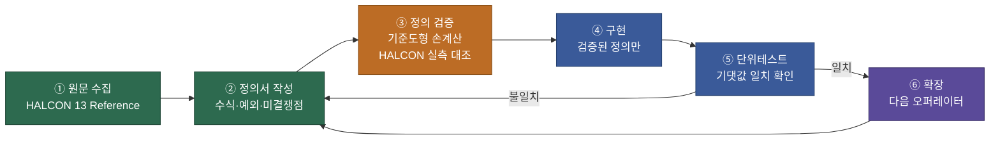

<div align="center">

# Halcon-Library

### HALCON 13 · Regions ▸ Features 자체 구현 엔진

**MVTec HALCON 의 리전 특징값 오퍼레이터 40종을, SDK 없이 C++ 로 재현합니다.**

<br>


<br>

</div>

---

## 왜 만드는가

2차전지 **코터 · 슬리터 · 롤프레스** 검사 프로그램은 불량 Blob 의 형상 특징값으로 불량을 분류합니다.
HALCON 은 이 영역의 사실상 표준이지만, **런타임 라이선스가 장비마다 필요**합니다.

이 프로젝트는 HALCON 13 의 `Regions ▸ Features` 오퍼레이터 40종을
**동일한 수치가 나오도록** C++ 로 자체 구현해, 라이선스 없이 같은 검사 로직을 쓰는 것이 목표입니다.

> ### ⚠ 이 프로젝트의 유일한 성공 기준
> **HALCON 실측값과 일치하는가.**
> 구현한 오퍼레이터 개수는 성과가 아닙니다. 값이 틀린 40종보다 값이 맞는 5종이 낫습니다.

---

## 진행 방식



**정의가 틀린 채로 짠 코드는 전부 폐기입니다.** 그래서 구현보다 정의와 검증이 앞섭니다.

---

## 현재 상태

| 단계 | 상태 | 산출물 |
|---|:--:|---|
| ① 원문 수집 | ✅ **완료** | 40종 전부 · [`docs/reference/halcon13/`](docs/reference/halcon13/) (2,094줄) |
| ② 정의서 | 🟡 **5 / 40** | [`docs/02_DEFINITIONS.md`](docs/02_DEFINITIONS.md) |
| ③ 정의 검증 | 🟡 손계산 완료 · 실측 대기 | [`docs/03_VERIFICATION.md`](docs/03_VERIFICATION.md) |
| ④ 구현 | ⬜ 미착수 | |
| ⑤ 단위테스트 | ⬜ 미착수 | |

### 1차 구현 대상 5종

기반 인프라(런렝스 Region · contour 추출 · convex hull)를 모두 요구하면서
해석적 검증이 명확한 조합으로 선정했습니다.

| 오퍼레이터 | 값 | 정의 | 검증 | 구현 |
|---|---|:--:|:--:|:--:|
| `area_center` | 면적 · 무게중심 | ✅ | ⬜ | ⬜ |
| `contlength` | 윤곽 길이 (구멍 제외) | ✅ | ⬜ | ⬜ |
| `circularity` | 원형도 `min(1, F/(max²π))` | ✅ | ⬜ | ⬜ |
| `compactness` | 조밀도 `max(1, L²/(4Fπ))` | ✅ | ⬜ | ⬜ |
| `convexity` | 볼록도 `F_o / F_c` | ✅ | ⬜ | ⬜ |

전체 40종 현황은 [`docs/00_OVERVIEW.md`](docs/00_OVERVIEW.md) 를 참고하세요.

---

## 원문 수집에서 드러난 것

HALCON 문서의 수식은 텍스트가 아니라 **MetaPost 인라인 SVG 글리프**로 렌더링되어 있습니다.
일반적인 크롤링·요약으로는 **수식이 통째로 누락되거나 분자·분모가 뒤집힙니다.**

그래서 HTML 글리프 ID를 TeX 폰트 인코딩으로 역매핑하고, SVG transform 좌표로
분수선과 첨자를 재구성해 수식을 복원했습니다. 그 과정에서 **통념과 어긋나는 지점 14건**을 확인했습니다.

<details>
<summary><b>대표 함정 8건 펼쳐보기</b></summary>

<br>

| # | 함정 | 통념 | HALCON 13 원문 |
|---|---|---|---|
| 1 | `compactness` 클리핑 방향 | `min` | **`max(1, L²/(4Fπ))`** — circularity 와 반대 |
| 2 | `convexity` 분자/분모 | 자주 뒤집힘 | **`F_o / F_c`** (원본면적 / 볼록껍질면적) |
| 3 | `contlength` 와 구멍 | 구멍 윤곽 포함 | **"The contour of holes is not calculated"** |
| 4 | `moments_region_2nd` 정규화 | 면적으로 나눔 | **정규화 없음(순수 합)** |
| 5 | 모멘트 부호 규약 | 일관됨 | 2nd 는 `(중심−픽셀)`, 3rd 는 `(픽셀−중심)` — **3차에서 부호가 뒤집힘** |
| 6 | `smallest_rectangle2` 의 Length | 전체 변 길이 | **반변(half length)** — `cv::minAreaRect` 와 2배 차이 |
| 7 | 픽셀 모델 | 면적 1의 사각형 | **무한소 점(픽셀 중심)** → 1px 두께 리전은 `Rb = 0` |
| 8 | `rectangularity` | `A / minAreaRect` 로 근사 | **닫힌 수식이 문서에 없음.** 1·2차 모멘트가 같은 사각형과의 차집합 기반 |

</details>

전체 14건은 [`docs/00_OVERVIEW.md`](docs/00_OVERVIEW.md) §5 에 있습니다.

---

## 아키텍처

```
┌──────────────────────────────────────────────────────────┐
│  Facade    namespace glim::halcon                        │  ← 사용처가 보는 전부
│            AreaCenter() Circularity() SelectShape() …    │     HALCON 이름 그대로
├──────────────────────────────────────────────────────────┤
│  Feature   FeatureContext   중간산물 캐시(지연계산)        │  ← 성능의 핵심
│            FeatureRegistry  "이름 → 계산함수"             │     select_shape 의 근간
├──────────────────────────────────────────────────────────┤
│  Core      Region (런렝스, 불변, shared_ptr)              │
│            Contour / ConvexHull / Moments                │
├──────────────────────────────────────────────────────────┤
│  Backend   OpenCV · 자체 알고리즘  (헤더 밖으로 안 나감)    │
└──────────────────────────────────────────────────────────┘
```

| 결정 | 이유 |
|---|---|
| **PIMPL — 공개 헤더에 OpenCV 노출 금지** | 사용처마다 OpenCV 버전·툴셋이 달라 링크가 깨진다 |
| **Facade — HALCON 이름 그대로** | 기존 HALCON 스크립트를 1:1 로 이식할 수 있어야 실제로 쓰인다 |
| **런렝스 Region** | `area_center` · 모멘트를 O(면적) 이 아닌 **O(런 수)** 로 계산 |
| **FeatureContext 캐시** | contour · hull · 모멘트는 여러 특징값이 공유 → 리전당 1회만 계산 |
| **가상함수 최소화** | 8스레드 실시간 검사 경로. 오퍼레이터는 무상태 순수 함수다 |

자세한 내용은 [`docs/01_ARCHITECTURE.md`](docs/01_ARCHITECTURE.md).

---

## 문서

| 문서 | 내용 |
|---|---|
| [`CLAUDE.md`](CLAUDE.md) | **작업 시작 전 필수.** AI 에이전트 / 신규 참여자 지침 |
| [`docs/00_OVERVIEW.md`](docs/00_OVERVIEW.md) | 범위 · 원칙 · 함정 14건 · 40종 현황표 |
| [`docs/01_ARCHITECTURE.md`](docs/01_ARCHITECTURE.md) | 설계 제약과 적용 패턴 |
| [`docs/02_DEFINITIONS.md`](docs/02_DEFINITIONS.md) | **특징값 정의서 — 구현의 유일한 근거** |
| [`docs/03_VERIFICATION.md`](docs/03_VERIFICATION.md) | 기준 도형 · 기댓값 손계산 · HDevelop 검증 스크립트 |
| [`docs/reference/halcon13/`](docs/reference/halcon13/) | HALCON 13 원문 수집 아카이브 (G1~G5) |

---

## 기여 규칙

1. **정의 → 검증 → 구현** 순서를 지킵니다. 정의서에 없는 오퍼레이터를 먼저 구현하지 않습니다.
2. 근거는 항상 `docs/reference/halcon13/` 의 **원문**입니다. 통념으로 대체하지 않습니다.
3. 원문에 없으면 **"문서에 명시 없음"** 으로 남기고 **미결 쟁점**으로 등록합니다.
4. 소스 파일 인코딩은 **UTF-8 BOM 필수** (BOM 없는 한글 주석은 VS 가 CP949 로 오독해 다음 줄을 삼킵니다).
5. 커밋은 **1기능 1커밋**, 컨벤셔널 커밋(`feat:` `fix:` `docs:` `test:`).

전체 지침은 [`CLAUDE.md`](CLAUDE.md) 를 읽어주세요.

---

<div align="center">
<sub>HALCON 은 MVTec Software GmbH 의 상표입니다. 이 프로젝트는 MVTec 과 무관하며,<br/>
공개된 오퍼레이터 <b>명세</b>를 근거로 한 독립 구현입니다. HALCON 코드를 포함하지 않습니다.</sub>
</div>
